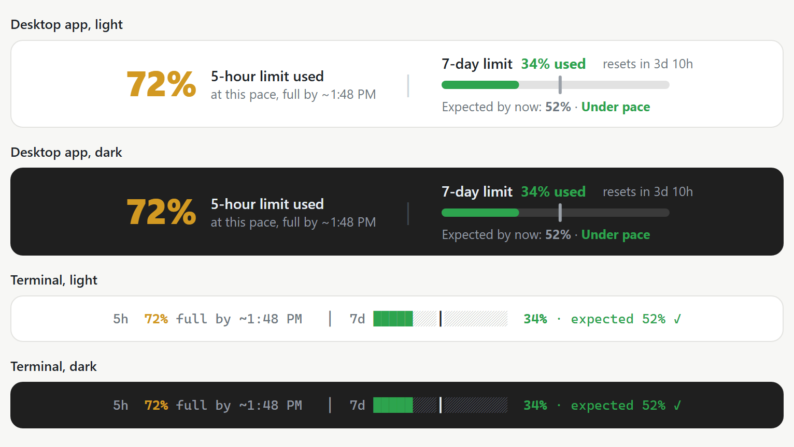

# claude-usage-band

**Know how close you are to your 5-hour and 7-day limits, and whether you're on pace, without ever typing `/usage`.**

A slim band that sits right above the Claude Code prompt, always visible, on the terminal and the desktop app. Context usage is left to Claude Code, which now shows it natively.



<sub>Sample figures, drawn from the mod's own layout: the 5-hour limit at 72% and on course to fill before its reset, the 7-day limit at 34% against 52% expected by now.</sub>

## Why you'll want it

- **Read the 5-hour limit in a blink.** It moves fast, so it gets one big number, colored green, amber or red.
- **Know when you'll run out.** Once the 5-hour number turns amber, the band says when this pace fills it (`full by ~1:48 PM`). When it's spent, it tells you when you're back (`back at 4:10 PM`).
- **See if the week is on track.** The 7-day limit moves slowly, so it gets a bar with a tick marking where an even pace would be by now, plus a verdict: under pace or ahead of pace.
- **Zero cost.** Read from what Claude Code already reports. No extra tokens, no network calls.
- **Looks right everywhere.** One row on the desktop app, stacked on a phone, one line in the terminal.

## What you get

```
5h  72% full by ~1:48 PM   │  7d █████░░░│░░░░░░░░  34% · expected 52% ✓
```

| Part | Shows |
| --- | --- |
| 5-hour number | Percent of the 5-hour limit used: green below 60%, amber to 85%, red above |
| 5-hour note | `resets in 3h 06m`, or `full by ~1:48 PM` when this pace runs out before the reset, or `back at 4:10 PM` once spent |
| 7-day bar | Percent of the 7-day limit used. The tick (`│`) marks how much you'd have used by now at an even pace |
| Verdict | `Under pace` ✓ or `Ahead of pace` ⚠. Ahead of pace turns a green 7-day figure amber |

A narrow terminal drops `expected 52%` first, then the 5-hour note. The ✓ / ⚠ verdict always stays.

`--` means there is no reading yet. The band steps aside while a survey is showing.

> On the Claude desktop app the band may draw below the message box rather than above it. The slot is documented as above the prompt, and a mod has no option to change where the host places it.

## Install

You need a recent [Claude Code](https://claude.com/claude-code). Built and tested on **2.1.296**; on an older build (2.1.274, for example) the plugin installs but the band does not appear. Check with `claude --version` and update with `claude update`.

### The easy way: ask Claude

Paste this into any Claude Code session (terminal, desktop app or VS Code) and let Claude do it:

```
Install the usage-band plugin from https://github.com/twentyTwo/claude-usage-band for my user.
First check `claude --version` is 2.1.296 or newer and run `claude update` if it isn't.
Then run `claude plugin marketplace add twentyTwo/claude-usage-band` and
`claude plugin install usage-band@claude-usage-band --scope user`,
and confirm with `claude plugin list` that it is enabled.
```

When Claude is done, run `/reload-plugins` yourself (Claude can't run slash commands for you). The band appears above the prompt.

To update or remove it later, ask the same way: *"Update the usage-band plugin"* or *"Uninstall the usage-band plugin and remove its marketplace"*.

### By hand

Installing takes two steps: add this repo as a marketplace, then install the plugin from it.

**1. Inside a Claude Code session**

```
/plugin marketplace add twentyTwo/claude-usage-band
/plugin install usage-band@claude-usage-band
```

**Or from a regular terminal**

```bash
claude plugin marketplace add twentyTwo/claude-usage-band
claude plugin install usage-band@claude-usage-band --scope user
```

**2. Reload**

Run `/reload-plugins`, or start a new session. The band appears above the prompt.

`--scope user` loads the band in every session. Leave it off to install for the current project only.

### Update

```bash
claude plugin marketplace update claude-usage-band
```

### Install from a local clone

```bash
git clone https://github.com/twentyTwo/claude-usage-band
claude plugin marketplace add ./claude-usage-band
claude plugin install usage-band@claude-usage-band --scope user
```

Run `/reload-plugins` after editing the files.

## Uninstall

```bash
claude plugin uninstall usage-band@claude-usage-band --scope user
claude plugin marketplace remove claude-usage-band
```

## Settings

| Setting | Default | What it does |
| --- | --- | --- |
| `colorMode` | `level` | `level`: each limit turns green below 60%, amber to 85%, red above. `fixed`: each limit keeps its own color. |
| `fiveHourColor` | `#f85149` | 5h color in `fixed` mode |
| `sevenDayColor` | `#2da44e` | 7d color in `fixed` mode |
| `terminalGlyphs` | `unicode` | `ascii` draws the terminal line with `#`, `-`, `|`, `ok` and `!`, for fonts that draw `█` `░` `│` `✓` `⚠` double-width |

Change them with `/plugin configure usage-band@claude-usage-band`.

## How it works

`hooks/register.tsx` reads the rate limits from `$.session.usage()` at session start and from the `session.measure` event after that, and keeps the last ones in the plugin's store so a new session starts with figures. A one-minute clock moves the countdowns on. A `ui.render` hook on the `AbovePrompt` component draws the band from that state.

## Develop

```bash
claude plugin validate .
claude plugin test .
```

The tests mount the band on the terminal, desktop and phone surfaces and check the figures, the 5-hour forecast, the 7-day pace verdict, the narrow-terminal fallbacks, fixed-color mode and the survey case.

## License

MIT
