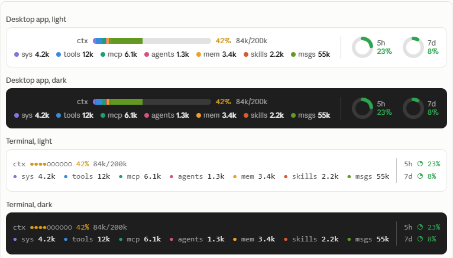

# claude-usage-band

**See what's eating your context window, and how close you are to your limits, without ever typing `/context` or `/usage`.**

A tiny colorful band that sits right above the Claude Code prompt, always visible, on both the terminal and the desktop app.



<sub>Sample figures, drawn from the mod's own layout.</sub>

## Why you'll want it

- **Know before it's too late.** Watch the context bar fill up and compact or start fresh before quality drops, not after.
- **See *what* is using your context.** One bar split into system prompt, tools, MCP tools, agents, memory files, skills and messages, each with its token count. Spot the bloated MCP server at a glance.
- **Never get surprised by a rate limit.** 5-hour and 7-day usage sit next to the prompt as small pies.
- **Zero cost.** Estimates are computed locally. No extra tokens, no network calls.
- **Looks right everywhere.** SVG meters on the desktop app, clean text meters (`●●●●○○○○○`, `◔ ◑ ◕`) in the terminal, light and dark.
- **Your colors.** Meters turn green, amber or red with the percentage, or keep a fixed color you choose.

## What you get

| Meter | Shows |
| --- | --- |
| **ctx** | Context window as a segmented bar, the percent, `used/window` tokens, and a chip per category |
| **5h** | Usage of the 5-hour rate-limit window |
| **7d** | Usage of the 7-day rate-limit window |

`--` means there is no reading yet. The band steps aside while a survey is showing.

> On the Claude desktop app the band may draw below the message box rather than above it. The slot is documented as above the prompt, and a mod has no option to change where the host places it.

## Quick start

```
/plugin install usage-band --marketplace twentyTwo/claude-usage-band
```

Answer `y` to add the marketplace, pick the **user** scope, and the band appears in your next session. Details below.

## Install

In a terminal Claude Code session:

```
/plugin install usage-band --marketplace twentyTwo/claude-usage-band
```

Answer `y` to add the marketplace, then pick the **user** scope so every session loads it. 

Or, from a clone:

```bash
claude plugin marketplace add /path/to/claude-usage-band
claude plugin install usage-band@claude-usage-band --scope user
```

Run `/reload-plugins` after editing the files.

## Uninstall

```bash
claude plugin uninstall usage-band@claude-usage-band --scope user
claude plugin marketplace remove claude-usage-band
```

## Settings

| Setting | Default | What it does |
| --- | --- | --- |
| `colorMode` | `level` | `level`: each meter turns green below 60%, amber to 85%, red above. `fixed`: each meter keeps its own color. |
| `contextColor` | `#f0883e` | ctx color in `fixed` mode |
| `fiveHourColor` | `#f85149` | 5h color in `fixed` mode |
| `sevenDayColor` | `#2da44e` | 7d color in `fixed` mode |

Change them with `/plugin configure usage-band@claude-usage-band`.

## How it works

`hooks/register.tsx` reads `$.session.usage()` at session start and the `session.measure` event after that. When the context figure changes it asks `$.session.usage({ breakdown: 'summary' })`, which estimates locally and costs nothing, and groups the rows of the breakdown by name. A `ui.render` hook on the `AbovePrompt` component draws the band from that state.

## Develop

```bash
claude plugin validate .
claude plugin test .
```

The tests mount the band on the terminal and desktop surfaces and check the figures, the category chips, fixed-color mode and the survey case.

## License

MIT
