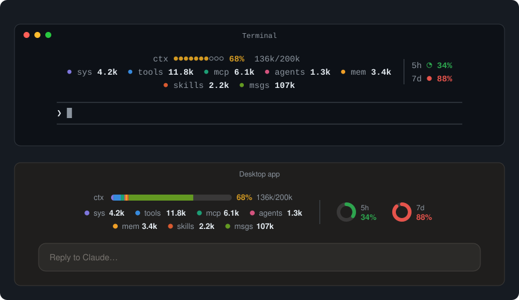

# claude-usage-band

A Claude Code mod that draws a small, colorful band directly above the prompt box:



<sub>Drawn from the mod's own layout with sample figures.</sub>

- **ctx**: the context window as one segmented bar, split by what fills it (system prompt, tools, MCP tools, agents, memory files, skills, messages), with the percent and `used/window` tokens, and a chip per category with its token count.
- **5h** and **7d**: the 5-hour and 7-day rate-limit windows as pies on the right.

Colors follow the percentage (green, amber, red) or stay fixed per meter, your choice. `--` means there is no reading yet. The band steps aside while a survey is showing.

On the terminal the pies and bar become text (`●●●●○○○○○○`, `◔ ◑ ◕`); on the desktop app they are drawn as SVG.

> On the Claude desktop app the band may draw below the message box rather than above it. The slot is documented as above the prompt, and a mod has no option to change where the host places it.

## Install

In a terminal Claude Code session:

```
/plugin install usage-band --marketplace twentyTwo/claude-usage-band
```

Answer `y` to add the marketplace, then pick the **user** scope so every session loads it. 

Or, from a clone:

```bash
claude plugin marketplace add /path/to/claude-usage-band
claude plugin install usage-band@claude-usage-band --scope user
```

Run `/reload-plugins` after editing the files.

## Uninstall

```bash
claude plugin uninstall usage-band@claude-usage-band --scope user
claude plugin marketplace remove claude-usage-band
```

## Settings

| Setting | Default | What it does |
| --- | --- | --- |
| `colorMode` | `level` | `level`: each meter turns green below 60%, amber to 85%, red above. `fixed`: each meter keeps its own color. |
| `contextColor` | `#f0883e` | ctx color in `fixed` mode |
| `fiveHourColor` | `#f85149` | 5h color in `fixed` mode |
| `sevenDayColor` | `#2da44e` | 7d color in `fixed` mode |

Change them with `/plugin configure usage-band@claude-usage-band`.

## How it works

`hooks/register.tsx` reads `$.session.usage()` at session start and the `session.measure` event after that. When the context figure changes it asks `$.session.usage({ breakdown: 'summary' })`, which estimates locally and costs nothing, and groups the rows of the breakdown by name. A `ui.render` hook on the `AbovePrompt` component draws the band from that state.

## Develop

```bash
claude plugin validate .
claude plugin test .
```

The tests mount the band on the terminal and desktop surfaces and check the figures, the category chips, fixed-color mode and the survey case.

## License

MIT
